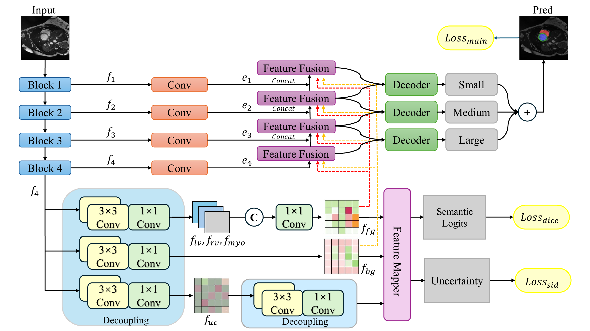
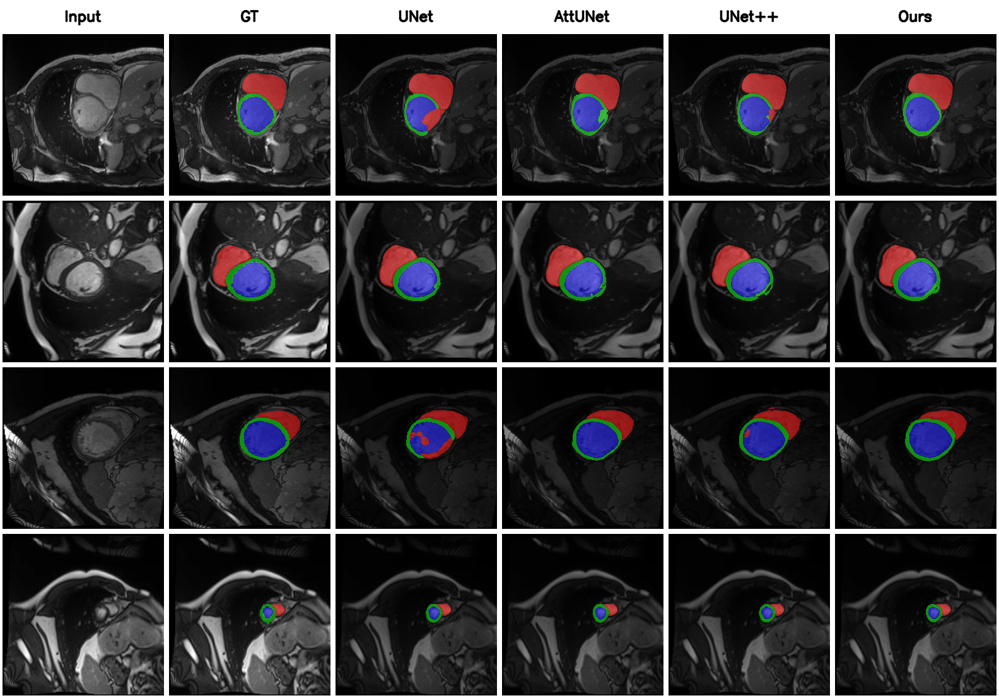

<h1 align="center">Multi-Class Cardiac MRI Segmentation<br>via Decoupled Feature Streams</h1>

<p align="center">Jiachen Shen · Xiaozhi Zhang<br>University of South China</p>

<p align="center">
  <a href="#overview">Overview</a> ·
  <a href="#results">Results</a> ·
  <a href="#installation">Installation</a> ·
  <a href="#data-preparation">Data</a> ·
  <a href="#training">Training</a> ·
  <a href="#evaluation">Evaluation</a>
</p>

## Overview

This repository implements multi-class cardiac MRI segmentation of the **right ventricle (RV), left ventricle (LV), and myocardium (Myo)** on ACDC 2017. Building on [ConDSeg](https://github.com/Mengqi-Lei/ConDSeg), the model extends feature decoupling to multiple cardiac structures and combines auxiliary boundary supervision with dynamic area weighting.



*Overall architecture: a ResNet-50 encoder, decoupled feature streams, contrast-driven feature aggregation, and multi-scale decoding. [Full diagram and auxiliary heads (PDF)](figures/architecture.pdf).*

## Results

Mean scores across RV, LV, and Myo, as reported in the manuscript. Dice is higher-is-better; HD95 is lower-is-better.

| Method | ED Dice | ED HD95 | ES Dice | ES HD95 |
| :--- | ---: | ---: | ---: | ---: |
| U-Net | 0.8906 | 11.2073 | 0.8527 | 24.7539 |
| Attention U-Net | 0.8990 | 10.4836 | 0.8614 | 22.5864 |
| UNet++ | 0.8967 | 10.9629 | 0.8647 | **19.7663** |
| **Ours** | **0.9043** | **8.8751** | **0.8654** | 21.3973 |

Evaluation uses 537 ED and 538 ES slices. HD95 follows this repository's slice-wise foreground-pixel protocol on resized images, including its empty-mask penalty; values are in **pixels**, not spacing-corrected 3D distances.



*Representative **ED** slices. Left to right: input, ground truth, U-Net, Attention U-Net, UNet++, and ours. Red: RV; green: Myo; blue: LV.*

## Installation

Download the repository, then run the following in a terminal. This example uses Python 3.12 and a CUDA 12.8 PyTorch build for a compatible NVIDIA GPU/driver. For other systems, select the appropriate build from the [official PyTorch installer](https://pytorch.org/get-started/locally/).

```bash
conda create -n cardiac-seg python=3.12 -y
conda activate cardiac-seg
cd condseg
python -m pip install --upgrade pip
python -m pip install torch --index-url https://download.pytorch.org/whl/cu128
python -m pip install -r requirements.txt
python -c "import torch; print('CUDA available:', torch.cuda.is_available())"
```

The training script requires CUDA; evaluation also supports CPU. For numerical reproduction, reuse the original experiment environment: `requirements.txt` lists dependencies rather than pinning the historical training environment, and augmentation behavior can vary with Albumentations versions.

## Data preparation

Use the preprocessed ACDC 2D slices. Place `data` next to the code directory, or pass a different root with `--data-root`:

```text
project/
├── condseg/
│   ├── train.py
│   ├── test.py
│   ├── network/            # Model, decoupling module, ResNet-50
│   └── utils/              # Dataset, losses, metrics, training loops
└── data/
    ├── ACDC2017/           # images/*.jpg, masks/*.png, train.txt, val.txt
    ├── ACDC2017test/       # images/*.jpg, masks/*.png, test.txt (ED)
    └── ACDC2017testES/     # images/*.jpg, masks/*.png, test.txt (ES)
```

Each manifest contains image stems, one per line. Images are resized to 256×256 and normalized to [0, 1]; masks use nearest-neighbor resizing. Stored grayscale values map to classes as follows: 85/127 → RV, 170/191 → Myo, 255 → LV, otherwise background. Use these encoded masks rather than raw 0–3 masks.

To reproduce the reported split, keep the original manifests unchanged: the legacy reader uses `split("\n")[:-1]`, so a missing final newline omits the last entry. Data and trained checkpoints are not included in this code package.

## Training

Run commands from the `condseg` directory:

```bash
python train.py
```

For a different data location:

```bash
python train.py --data-root /path/to/data
```

Training settings are grouped in `train.py`. Logs and the best checkpoint are saved under `run_files/ACDC2017/<run-name>/`; selection uses validation mean Dice. ResNet-50 starts from ImageNet weights, downloaded on first use if not cached. `--resume /path/to/checkpoint.pth` loads model weights only, without restoring optimizer or scheduler state.

## Evaluation

Provide the main-model checkpoint explicitly. ED is the default test subset:

```bash
# ED
python test.py --checkpoint /path/to/checkpoint.pth

# ES
python test.py --checkpoint /path/to/checkpoint.pth --dataset ACDC2017testES

# First four slices, metrics only
python test.py --checkpoint /path/to/checkpoint.pth --max-samples 4 --workers 0 --no-save-preds --no-save-overlay
```

Add `--data-root /path/to/data` when needed. Full-test output goes to `results/<dataset>/Ours/`; a limited test uses `Ours_smoke<N>/`.

To control image saving directly, edit the switches near the top of `test.py`:

```python
SAVE_PRED_MASKS = True       # False: skip predicted masks
SAVE_OVERLAY_IMAGES = True   # False: skip image overlays
```

Metrics are saved to `test_metrics.txt`; enabled images go to `pred_masks/` and `overlay/`. Set both switches to `False` for metrics only. The `--no-save-preds` and `--no-save-overlay` flags can also disable image output for an individual run.

## Acknowledgements

This implementation builds on [ConDSeg](https://github.com/Mengqi-Lei/ConDSeg) by Mengqi Lei et al. The model is implemented as `CardiacDecoupledSegNet`; `ConDSeg` remains an alias for compatibility with existing loading scripts. This package contains the proposed model; the baseline and ablation implementations are not included.
